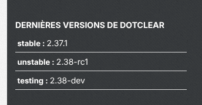
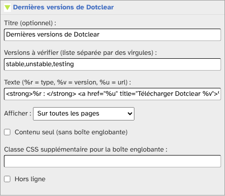
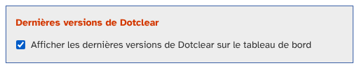
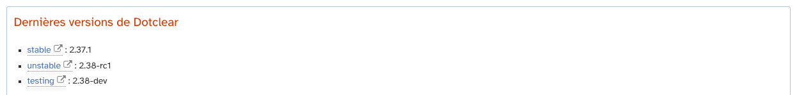
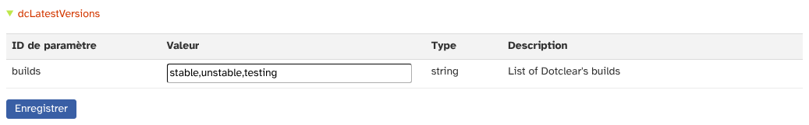

# Dotclear's latest versions : guide d'utilisation

Ce guide explique comment afficher les dernières versions de Dotclear sur votre blog et sur votre tableau de bord.

Ce plugin n'a pas de page d'administration. Il ajoute un widget et une boîte du tableau de bord.

## Sommaire

* [À quoi sert le plugin](#à-quoi-sert-le-plugin)
* [Ajouter le widget](#ajouter-le-widget)
* [Régler le texte du widget](#régler-le-texte-du-widget)
* [Afficher les versions sur le tableau de bord](#afficher-les-versions-sur-le-tableau-de-bord)
* [Choisir les versions à suivre](#choisir-les-versions-à-suivre)
* [Bon à savoir](#bon-à-savoir)

## À quoi sert le plugin

Dotclear publie plusieurs versions en parallèle : la version stable, une version instable (candidate) et une version de test (_testing_).

Le plugin interroge le site de Dotclear et affiche, pour chacune, le numéro de la dernière version avec un lien de téléchargement.

## Ajouter le widget

1. Allez dans _Blog_ puis _Widgets_.
2. Dans la liste des widgets disponibles, trouvez _Dernières versions de Dotclear_.
3. Ajoutez-le au volet de votre choix.
4. Cliquez sur son nom pour ouvrir ses réglages, puis sur _Enregistrer_.

Voici le résultat sur le blog :

Chaque ligne montre le type de version, puis le numéro qui sert de lien vers le téléchargement.

## Régler le texte du widget

* _Titre (optionnel)_ : le titre du widget.
* _Versions à vérifier (liste séparée par des virgules)_ : les types de version à afficher dans ce widget. Le champ reprend la liste générale (voir plus bas) quand vous ajoutez le widget. Si vous le videz, le widget suit la liste générale.
* _Texte_ : le modèle d'une ligne. Trois codes sont remplacés : `%r` par le type de version (stable, unstable, testing), `%v` par le numéro et `%u` par l'adresse de téléchargement. Le HTML est accepté.
* _Afficher_ : sur toutes les pages ou seulement en page d'accueil.
* _Contenu seul (sans boîte englobante)_ : supprime la boîte autour du widget.
* _Classe CSS supplémentaire pour la boîte englobante_ : ajoute votre classe CSS.
* _Hors ligne_ : cache le widget sans le supprimer.

Le texte par défaut donne une ligne comme « stable : 2.37.1 ». Si vous videz le champ _Texte_, le widget ne s'affiche plus.

## Afficher les versions sur le tableau de bord

Les versions peuvent aussi apparaître sur votre tableau de bord d'administration.

1. Allez dans _Mes préférences_ puis _Mon tableau de bord_.
2. Cochez _Afficher les dernières versions de Dotclear sur le tableau de bord_.
3. Enregistrez les options du tableau de bord.

Une boîte apparaît ensuite sur la page d'accueil de l'administration. Chaque type de version est un lien de téléchargement, suivi du numéro.

Cette option est personnelle : chaque utilisateur choisit pour lui-même.

## Choisir les versions à suivre

Par défaut, le plugin suit trois types : `stable,unstable,testing`. Cette liste générale sert à la boîte du tableau de bord, et aux widgets dont le champ _Versions à vérifier_ est vide.

Pour changer cette liste, utilisez la page _about:config_ (plugin _aboutConfig_, fourni avec Dotclear) :

1. Allez dans _Système_ puis _about:config_.
2. Dans les réglages du blog, ouvrez le groupe `dcLatestVersions`.
3. Modifiez la valeur de `builds`, avec les types séparés par des virgules.
4. Cliquez sur _Enregistrer_.

Les majuscules et les espaces autour des noms sont ignorés. Un type inconnu du site de Dotclear est simplement ignoré.

## Bon à savoir

* Le site de Dotclear est interrogé au plus toutes les six heures. Entre deux, le plugin utilise une copie gardée en cache.
* Si le site de Dotclear n'est pas joignable et qu'aucune copie n'existe, rien ne s'affiche : ni le widget, ni la boîte du tableau de bord. Aucun message n'explique pourquoi. Le plugin attend alors une heure avant d'interroger à nouveau le site, pour ne pas ralentir vos pages.
* Si la liste `builds` est vide (et le champ du widget aussi), rien ne s'affiche non plus.
* Le widget et la boîte montrent seulement le numéro de version et le lien. Ils ne comparent pas avec la version installée sur votre blog.
